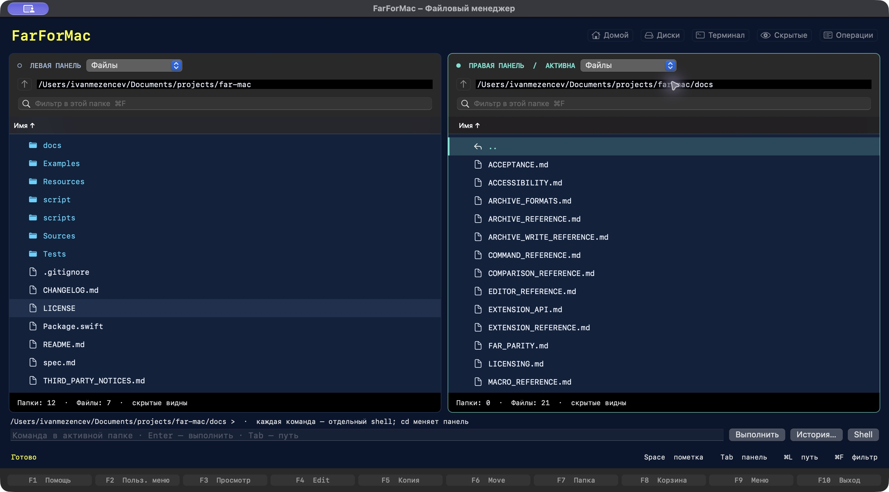

# FarForMac

**Две панели. Привычные клавиши FAR. Отдельное приложение для macOS.**

Файлы, архивы и удалённые серверы в одном окне: копируйте, ищите, редактируйте и запускайте команды с клавиатуры. FarForMac вдохновлён Far Manager и написан на Swift/AppKit.

[**Опубликованный выпуск 0.7.0**](https://github.com/megabars/FarForMac/releases/tag/v0.7.0) · [Что нового](CHANGELOG.md) · [План развития](spec.md)



## Возможности

- **Файловые панели.** Пометки и маски, фильтр, сортировка, избранное и история папок. Дерево каталогов, быстрый просмотр, сравнение каталогов, импорт/экспорт списков и десять общих временных панелей.
- **Операции с файлами.** Копирование, перенос, переименование, создание папок и Корзина. Фоновая очередь с прогрессом, отменой и выбором действий при совпадении имён; групповое переименование по маскам FAR или шаблону с предпросмотром; описания descript.ion сопровождают локальные операции; рекурсивные даты, POSIX-права и разрешённая группа — с подтверждением.
- **Поиск.** По имени, тексту или HEX-байтам, с масками, регулярными выражениями, ограничениями размера и даты. Подстрока и HEX ищутся по частям в локальных файлах до 4 ГиБ; F3 из HEX-результата открывает найденную байтовую позицию. Флаги «Искать в архивах» и «Включая вложенные архивы» находят файлы внутри локальных контейнеров. Alt+F7 работает также внутри открытого архива и сетевой папки; содержимое там ограничено 64 МиБ на файл. Один запрос объединяет папки, архивы и подключения. Результаты открываются через Enter/F3/F4 и собираются в смешанную временную панель; F5 копирует выбранное в обычную папку, F7 убирает ссылки. Последний смешанный список и десять общих слотов сохраняются между запусками. Открытие списка не подключается к сети; Enter/F3/F4/F5 восстанавливают выбранный источник и при необходимости запрашивают вход.
- **Просмотр и редактор.** Просмотр больших файлов: текст/dump/hex, соседние файлы панели, целые слова, нестрогий поиск и поиск по кругу, слежение за растущим файлом. Редактор: кодировки и LF/CRLF/CR, нестрогий поиск, замена с сохранением регистра и стиля `camelCase` / `snake_case` / `kebab-case`, все совпадения, блоки, закладки, расширенный переход и черновики.
- **Архивы и сеть.** ZIP/ZIP64 и TAR, включая gzip/bzip2/xz, открываются как панели: просмотр, извлечение, добавление и редактирование файлов; F6 переименовывает внутри архива, F7 создаёт папку. Вложенные архивы открываются только для чтения, Esc возвращает к родительскому. Подключения SFTP, FTP/FTPS и WebDAV — через **Сеть → Подключиться**. Есть перенос папок между Mac и сервером, слияние с выбором пропуска/замены/нового имени, предпросмотр удаления SFTP/FTP и перемещение внутри SFTP/WebDAV. SSH-соединение и переходы сохраняются между операциями без повторного MFA. SMB-диски macOS доступны как обычные папки.
- **Команды и автоматизация.** Командная строка, встроенная терминальная сессия, импорт FarMenu.ini, параметры команд и списки файлов, шесть действий ассоциаций. Макросы с условиями, повторами и своими клавишами; API расширений.

## Установка

Скачайте `FarForMac-0.7.0-3-arm64.zip` из [релиза](https://github.com/megabars/FarForMac/releases/tag/v0.7.0), распакуйте и перенесите `FarForMac.app` в «Программы».

Готовая сборка предназначена для **Apple Silicon**. В проекте указана **macOS 14+**, проверка всех поддерживаемых систем ещё продолжается. Выпуск предварительный: подписи Developer ID и notarization пока нет, поэтому macOS может заблокировать первый запуск. Подробности — в [описании выпуска](https://github.com/megabars/FarForMac/releases/tag/v0.7.0).

В текущей версии исходников **0.8.0 (сборка 4)** добавлены **общий поиск по нескольким источникам, сохраняемые смешанные временные панели и общие слоты, автоматический поиск в архивах и вложенных архивах, HEX-поиск, нестрогий поиск и замена с сохранением стиля, перенос сетевых папок, повторное использование SSH/MFA и доработки терминала, команд, макросов и панелей** — [подробности](CHANGELOG.md). Для сборки 0.8.0 выполните `./script/package_release.sh`: приложение и ZIP появятся в `dist/`. Опубликованный архив 0.7.0 не обновлялся.

## Основные клавиши

⌘ — Command, ⌥ — Option, ⇧ — Shift. Для F-клавиш на Mac может потребоваться **Fn**; команды также доступны через меню и кнопки внизу окна.

| Клавиши | Действие |
| --- | --- |
| Tab · Enter · Backspace | Другая панель · открыть · на уровень выше |
| Space / Insert · ⌘A | Пометить объект · пометить всё |
| ⌘L · ⌘F | Ввести путь · фильтр текущей панели |
| ⌘R · ⌘. | Обновить · показать/скрыть скрытые файлы |
| F1 · F2 | Справка · пользовательское меню |
| F3 · F4 | Просмотр · редактор; для папки — размер · свойства |
| F5 · F6 | Копировать · переместить/переименовать |
| F7 · F8 | Создать папку · переместить в Корзину в обычной файловой панели |
| F9 · F10 | Меню команд · выход |
| ⌥F7 / ⌘⇧F | Найти файлы |
| Ctrl+PageDown · Esc | Открыть как архив, в том числе вложенный · вернуться к родительскому архиву |
| ⌘J | Очередь операций и журнал |
| Ctrl+O | Переключить панели и терминальный экран |
| Ctrl+T · Ctrl+L · Ctrl+Q | Дерево · информация · быстрый просмотр |
| ⇧F4 / ⌘N | Новый документ |
| ⌘S · ⌘⇧S | В редакторе: сохранить · сохранить как |
| ⌘F · ⌘⌥F | В редакторе: найти · заменить |

**F5/F6/F8 работают с помеченными объектами**, а если пометок нет — с объектом под курсором. ⇧F5/⇧F6 обрабатывают только объект под курсором. Отмена операции сохраняет уже выполненные изменения.

## Настройки

| Где открыть | Что можно изменить |
| --- | --- |
| **FarForMac → Доступность и язык…** или **⌘,** | Русский/English, размер текста **85–150%**, повышенный контраст. Английский перевод пока частичный. |
| **Панели → Настройки активной панели…** | Краткий/полный вид или свои колонки, сортировка, папки первыми, учёт регистра, естественный порядок и раскраска. Настройки сохраняются отдельно для каждой панели. |
| **Командная строка → Сохранять состояние shell** | Постоянный zsh с переменными и функциями; две кнопки синхронизации папки панели и shell. |
| **Команды**, **Пометки**, **Автоматизация** | Пользовательское меню, ассоциации, маски и макросы. Импорт FarMenu.ini, условия/повторы макросов и клавиши с проверкой конфликтов; привязки включаются отдельно. |
| **Расширения** в редакторе | EditCase: пять режимов регистра для выделения/слова. Align: форматирование выбранных строк с настройкой ширины; применение через предпросмотр и Undo. |
| **Файлы → Переносить описания вместе с файлами** | Автообновление descript.ion для новых локальных заданий. Кодировка UTF-8/Windows-1251/DOS-866 выбирается в окне описания и запоминается для папки. |
| **Сеть → Подключиться** | Протокол, параметры сервера и профили. Для SFTP — ключ/agent, пароль или MFA; импорт SSH config и цепочка промежуточных серверов. Пароли можно сохранять в Keychain по желанию. |

## Что пока ограничено

Редактор открывает файлы до **8 МиБ**. SFTP поддерживает **ключи/agent, пароль и keyboard-interactive/MFA**, в том числе на промежуточных серверах. Импорт SSH config ограничен основными параметрами; соединение и цепочка переходов переиспользуются между операциями; новое подключение требует нового MFA-входа. 7z/RAR и запись во вложенные архивы пока недоступны. При сетевом слиянии доступны пропуск, замена обычного файла и другое имя. F6 переносит дерево после проверки копии: на SFTP/WebDAV или с SFTP/FTP/FTPS. Скачивание с удалением WebDAV-папок и межсерверная передача пока недоступны. Полный паритет с FAR и совместимость с его плагинами не заявлены.

Подробнее: [сеть](docs/NETWORK_CAPABILITIES.md) · [архивы](docs/ARCHIVE_FORMATS.md) · [команды](docs/COMMAND_REFERENCE.md) · [макросы](docs/MACRO_REFERENCE.md) · [расширения](docs/EXTENSION_API.md).

<details>
<summary><strong>Сборка из исходников</strong></summary>

Нужны macOS 14+ и Swift 6+ из Xcode или Command Line Tools.

```sh
./script/build_and_run.sh
```

Скрипт соберёт и откроет `dist/FarForMac.app`. Только сборка: `./script/build_and_run.sh --build-only`. Для тестов нужен Python 3 и тестовый SSH-сервер (в приложение не включается):

```sh
python3 -m venv .build/test-python
.build/test-python/bin/python -m pip install -r Tests/NetworkFixtures/requirements-ssh-password.txt
FAR_TEST_PYTHON="$PWD/.build/test-python/bin/python" ./script/test.sh
```

Состояние проверок — в [журнале приёмки](docs/ACCEPTANCE.md).

</details>

## Лицензия

© 2026 **Ivan Mezentsev**. Проприетарное приложение: **0.7.0 и 0.8.0 бесплатны для тестирования и оценки** без фиксированного срока окончания при соблюдении [LICENSE](LICENSE). Обычное производственное использование за пределами оценки и распространение требуют отдельного разрешения с учётом исключений в лицензии. Будущие версии могут быть платными. [Пояснение](docs/LICENSING.md) · [Сторонние компоненты](THIRD_PARTY_NOTICES.md).
